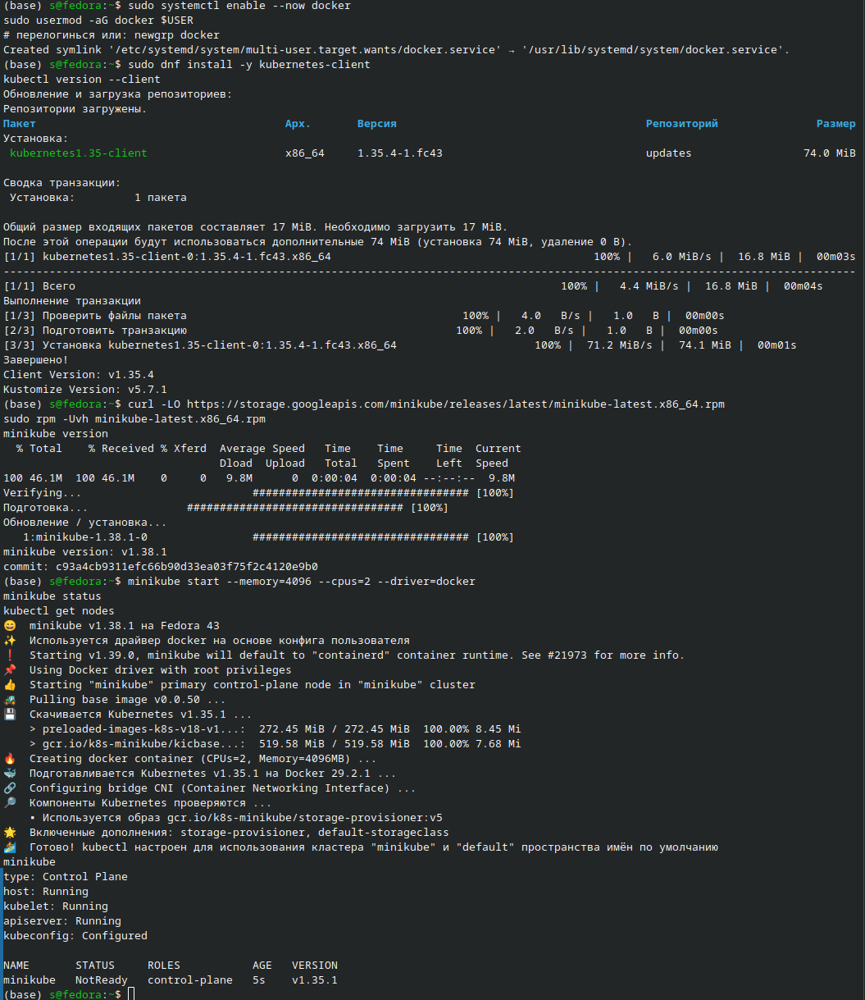

```
(base) s@fedora:~$ sudo systemctl enable --now docker
sudo usermod -aG docker $USER
# перелогинься или: newgrp docker
Created symlink '/etc/systemd/system/multi-user.target.wants/docker.service' → '/usr/lib/systemd/system/docker.service'.
(base) s@fedora:~$ sudo dnf install -y kubernetes-client
kubectl version --client
Обновление и загрузка репозиториев:
Репозитории загружены.
Пакет                                      Арх.       Версия                                      Репозиторий               Размер
Установка:
 kubernetes1.35-client                     x86_64     1.35.4-1.fc43                               updates                 74.0 MiB

Сводка транзакции:
 Установка:         1 пакета

Общий размер входящих пакетов составляет 17 MiB. Необходимо загрузить 17 MiB.
После этой операции будут использоваться дополнительные 74 MiB (установка 74 MiB, удаление 0 B).
[1/1] kubernetes1.35-client-0:1.35.4-1.fc43.x86_64                                        100% |   6.0 MiB/s |  16.8 MiB |  00m03s
----------------------------------------------------------------------------------------------------------------------------------
[1/1] Всего                                                                          100% |   4.4 MiB/s |  16.8 MiB |  00m04s
Выполнение транзакции
[1/3] Проверить файлы пакета                                          100% |   4.0   B/s |   1.0   B |  00m00s
[2/3] Подготовить транзакцию                                         100% |   2.0   B/s |   1.0   B |  00m00s
[3/3] Установка kubernetes1.35-client-0:1.35.4-1.fc43.x86_64                     100% |  71.2 MiB/s |  74.1 MiB |  00m01s
Завершено!
Client Version: v1.35.4
Kustomize Version: v5.7.1
(base) s@fedora:~$ curl -LO https://storage.googleapis.com/minikube/releases/latest/minikube-latest.x86_64.rpm
sudo rpm -Uvh minikube-latest.x86_64.rpm
minikube version
  % Total    % Received % Xferd  Average Speed   Time    Time     Time  Current
                                 Dload  Upload   Total   Spent    Left  Speed
100 46.1M  100 46.1M    0     0   9.8M      0  0:00:04  0:00:04 --:--:--  9.8M
Verifying...                          ################################# [100%]
Подготовка...               ################################# [100%]
Обновление / установка...
   1:minikube-1.38.1-0                ################################# [100%]
minikube version: v1.38.1
commit: c93a4cb9311efc66b90d33ea03f75f2c4120e9b0
(base) s@fedora:~$ minikube start --memory=4096 --cpus=2 --driver=docker
minikube status
kubectl get nodes
😄  minikube v1.38.1 на Fedora 43
✨  Используется драйвер docker на основе конфига пользователя
❗  Starting v1.39.0, minikube will default to "containerd" container runtime. See #21973 for more info.
📌  Using Docker driver with root privileges
👍  Starting "minikube" primary control-plane node in "minikube" cluster
🚜  Pulling base image v0.0.50 ...
💾  Скачивается Kubernetes v1.35.1 ...
    > preloaded-images-k8s-v18-v1...:  272.45 MiB / 272.45 MiB  100.00% 8.45 Mi
    > gcr.io/k8s-minikube/kicbase...:  519.58 MiB / 519.58 MiB  100.00% 7.68 Mi
🔥  Creating docker container (CPUs=2, Memory=4096MB) ...
🐳  Подготавливается Kubernetes v1.35.1 на Docker 29.2.1 ...
🔗  Configuring bridge CNI (Container Networking Interface) ...
🔎  Компоненты Kubernetes проверяются ...
    ▪ Используется образ gcr.io/k8s-minikube/storage-provisioner:v5
🌟  Включенные дополнения: storage-provisioner, default-storageclass
🏄  Готово! kubectl настроен для использования кластера "minikube" и "default" пространства имён по умолчанию
minikube
type: Control Plane
host: Running
kubelet: Running
apiserver: Running
kubeconfig: Configured

NAME       STATUS     ROLES           AGE   VERSION
minikube   NotReady   control-plane   5s    v1.35.1
(base) s@fedora:~$ 

```